

   <h1>Standard Open SO-100 & SO-101 Arms</h1>
   

   
   

<h2>
    
Build Your Own SO-101 Robot!

</h2>

SO‑101 是 SO‑100 机械臂的下一代版本，最初由[RobotStudio](https://www.therobotstudio.com)与[Hugging Face](https://huggingface.co/lerobot)合作设计。它改进了接线，更容易组装（无需拆卸齿轮），并为引导臂使用更新的电机。

这些手臂旨在与开源 🤗 LeRobot 库无缝协作。加入我们的[Discord](https://discord.gg/ggrqhPTsMe)社区，在硬件和软件方面进行协作，并帮助让机器人技术的端到端 AI 变得更容易使用。

### 文档📖
- 对于 SO-101 文档，请进一步关注此页面。
- 在这里您可以找到已弃用的[SO‑100 docs](SO100.md)。

### 拥有您自己的 SO-101
您有两个选择：
- **自己构建**
   - 从[Bill of Materials](#sourcing-parts)获取组件。
   - 3D 打印零件（或订购 3D 打印零件），如[Printing the Parts](#printing-the-parts)中所述。
   - 关注我们的[Assembly Guide](https://huggingface.co/docs/lerobot/so101)。
- **购买套件**
   - 从供应商[here](#kits)之一购买组装好的手臂或零件套件。
   - 可选择遵循我们的[Assembly Guide](https://huggingface.co/docs/lerobot/so101)。

### 使用LeRobot进行设置🤗
采购完所有零件后，您可以使用 LeRobot[tutorial](https://huggingface.co/docs/lerobot/so101)设置您的 SO-101。

### 可选硬件🔧
该存储库还包括一系列可选的硬件设计，例如凸起的引导底座和不同的相机支架。在这里您可以探索[full list](#optional-hardware)。

## 套件

您可以在此处找到 SO-100/SO-101 套件的所有可选件：

- 来自 PartaBot :us:[US](https://partabot.com)（其中包括**组装的**版本，还销售 LeKiwi 和 Koch 机器人）
- 来自 Seeed studio :earth_africa:[International](https://www.seeedstudio.com/SO-ARM100-Low-Cost-AI-Arm-Kit.html)或 :cn:[China](https://item.taobao.com/item.htm?id=878010637397&skuId=5915703371829&spm=a213gs.v2success.0.0.4cbf4831mkqWLn)或 :jp:[Akizuki Denshi](https://akizukidenshi.com/catalog/g/g131169/)或[Aliexpress](https://www.aliexpress.com/item/3256808696884714.html?gatewayAdapt=4itemAdapt)（其中包括**3d 打印套件**）
- 来自 WowRobo :earth_africa:[International](https://shop.wowrobo.com/products/so-arm101-diy-kit-assembled-version-1)或 :cn:[China](https://item.taobao.com/item.htm?ft=t&id=860171734711)（其中包括**组装的**版本）
- 来自 RoboSEasy :kr:[South Korea](https://smartstore.naver.com/roboseasy)
- 来自 NeoBot :cn:[China](https://item.taobao.com/item.htm?ft=t&id=957685951340)
- 来自自动发现：eu：[EU](https://autodiscovery.eu/en/products/so-101-kit??utm_source=hf&utm_medium=shop&utm_content=web)

此外，您还可以在[Phospho](https://robots.phospho.ai)上找到 SO-100 从动臂套件（无引导臂）。如果您拥有 VR 耳机，它会特别有用。

## 采购零件

这种远程操作设置的从动臂和引导臂几乎与现成的部件相同（电机除外）。如果您计划创建与`LeRobot`库一起使用的经典远程操作设置，请从下面的两臂零件购买。

目前我们仅提供美国、欧盟、中国和日本的链接。如果您找到其他国家/地区的链接，请创建问题或 PR，以便我们将其添加到列表中。请注意，价格和商品可能会因地理位置而异。

> [！重要的]
> 从动臂的 STS3215 电机有两种尺寸。 7.4V 在 6V 时的失速扭矩为 16.5kg.cm（对于 5V 电源可能稍小一些）。 12V版本的堵转扭矩为30kg.cm。虽然我们发现 7.4V 就足够了，但如果您想要更强大的电机，您可以购买 12V 版本[here](https://www.alibaba.com/product-detail/6PCS-12V-30KG-STS3215-High-Torque_1601216757543.html)。请注意，如果您这样做，您还必须购买 12V 5A+ 电源，而不是 5V 电源。 SO101 的引导臂始终为 7.4V。

#### 两个手臂的零件（跟随者和领导者设置）：

| Part                                        | Amount | Unit Cost (US) | Buy US                                                                                                    | Unit Cost (EU) | Buy EU                                                                                            | Unit Cost (RMB) | Buy CN                                                                          | Unit Cost (JPY) | Buy JP                                                                          |
| ------------------------------------------- | ------ | -------------- | --------------------------------------------------------------------------------------------------------- | -------------- | ------------------------------------------------------------------------------------------------- | --------------- | ------------------------------------------------------------------------------- | --------------- | ------------------------------------------------------------------------------- |
| STS3215 Servo 7.4V, 1/345 gear (C001) **[2](#leaderbundle)  | 7     | $13.89            | [Alibaba](https://www.alibaba.com/product-detail/Top-Seller-Low-Cost-Feetech-STS3215_1600999461525.html)         | €12.2           | [Alibaba](https://www.alibaba.com/product-detail/Top-Seller-Low-Cost-Feetech-STS3215_1600999461525.html) | ￥97.72         | [TaoBao](https://item.taobao.com/item.htm?id=712179366565&skuId=5268252241438)  | ￥2,980         | [Akizuki Denshi](https://akizukidenshi.com/catalog/g/g116312/)  |
| STS3215 Servo 7.4V, 1/191 gear (C044) **[2](#leaderbundle)   | 2     | $13.89            | [Alibaba](https://www.alibaba.com/product-detail/Feetech-STS3215-SO-ARM101-Servo-7_1601430747897.html?spm=a2747.product_manager.0.0.59a371d2W4e0SR)         | €12.2           | [Alibaba](https://www.alibaba.com/product-detail/Feetech-STS3215-SO-ARM101-Servo-7_1601430747897.html?spm=a2747.product_manager.0.0.59a371d2W4e0SR) | ￥97.72         | -  | ￥2,980         | [Akizuki Denshi](https://akizukidenshi.com/catalog/g/g131131/)  |
| STS3215 Servo 7.4V, 1/147 gear (C046) **[2](#leaderbundle)    | 3     | $13.89            | [Alibaba](https://www.alibaba.com/product-detail/Feetech-STS3215-SO-ARM101-Servo-7_1601430760797.html?spm=a2747.product_manager.0.0.167371d25QeX3F)         | €12.2           | [Alibaba](https://www.alibaba.com/product-detail/Feetech-STS3215-SO-ARM101-Servo-7_1601430760797.html?spm=a2747.product_manager.0.0.167371d25QeX3F) | ￥97.72         | -  | ￥2,980         | [Akizuki Denshi](https://akizukidenshi.com/catalog/g/g131132/)  |
| Motor Control Board                         | 2      | $10.6           | [Amazon](https://www.amazon.com/Waveshare-Integrates-Control-Circuit-Supports/dp/B0CTMM4LWK/)             | €11.4            | [Amazon](https://www.amazon.fr/-/en/dp/B0CJ6TP3TP/)                                               | ￥27            | [TaoBao](https://detail.tmall.com/item.htm?id=738817173460&skuId=5096283384143) | ￥980         | [Akizuki Denshi](https://akizukidenshi.com/catalog/g/g131227/)  |
| USB-C Cable 2 pcs                           | 1      | $7             | [Amazon](https://www.amazon.com/Charging-etguuds-Charger-Braided-Compatible/dp/B0B8NWLLW2/?th=1)          | €7             | [Amazon](https://www.amazon.fr/dp/B07BNF842T/)                                                    | ￥23.9\*2       | [TaoBao](https://detail.tmall.com/item.htm?id=44425281296&skuId=5611379016222)  | ￥1,498         | [Amazon](https://www.amazon.co.jp/dp/B0C3H9L6KZ)  |
| Power Supply    | 2      | $10            | [Amazon](https://www.amazon.com/Facmogu-Switching-Transformer-Compatible-5-5x2-1mm/dp/B087LY41PV/)        | €15.7            | [Amazon](https://www.amazon.fr/-/en/dp/B01HRR9GY4/)                                               | ￥22.31         | [TaoBao](https://item.taobao.com/item.htm?id=544824248494&skuId=4974994129990)  | ￥1,550         | [Akizuki Denshi](https://akizukidenshi.com/catalog/g/g106238/)  |
| Table Clamp 4pcs                            | 1      | $9             | [Amazon](https://www.amazon.com/TAODAN-Trigger-Ratchet-Woodworking-Processes/dp/B0DJNXF8WH?rps=1&sr=1-18) | €9.7 | [Amazon](https://www.amazon.fr/Connex-COXT865210-Lot-Serre-joints-bricolage/dp/B00NA3T2CQ)      | ￥5.2*4 | [TaoBao](https://detail.tmall.com/item.htm?id=801399113134&skuId=5633627126649)                   | ￥2,200         | [Amazon](https://www.amazon.co.jp/dp/B0DJNXF8WH)  |
| Screwdriver Set[1](#myfootnote1) | 1      | $6             | [Amazon](https://www.amazon.com/Precision-Phillips-Screwdriver-Electronics-Computer/dp/B0DB227RTH)        | €9            | [Amazon](https://www.amazon.fr/Vinabo-Magnétique-Electronique-Réparation-Informatique/dp/B0BNQBNFFJ)                                                    | ￥14.9          | [TaoBao](https://detail.tmall.com/item.htm?id=675684600845&skuId=4856851392176) | ￥500         | [Amazon](https://www.amazon.co.jp/dp/B01MDNJVMN)  |
| Total                                       | ---    | $229.88           | ---                                                                                                       | €226.3           | ---                                                                                               | ￥1343.16       | ---                                                                             | ￥44,530         | ---                                                                             |

<a name="leaderbundle">2</a>: You can buy **all six STS3215 servos needed for the SO-101 leader arm**  
（3 × 1/147 齿轮 (C046)、2 × 1/191 齿轮 (C044)、1 × 1/345 齿轮 (C001)）在[Alibaba](https://www.alibaba.com/product-detail/6PCS-7-4V-STS3215-Servos-for_1601428584027.html?spm=a2747.product_manager.0.0.757c2c3clU7uH3)上的单个捆绑包中。

#### 一根从动臂零件：

| Part                                        | Amount | Unit Cost (US) | Buy US                                                                                                                                                | Unit Cost (EU) | Buy EU                                                                                                                                                | Unit Cost (RMB) | Buy CN                                                                          | Unit Cost (JPY) | Buy JP                                                                          |
| ------------------------------------------- | ------ | -------------- | ----------------------------------------------------------------------------------------------------------------------------------------------------- | -------------- | ----------------------------------------------------------------------------------------------------------------------------------------------------- | --------------- | ------------------------------------------------------------------------------- | --------------- | ------------------------------------------------------------------------------- |
| STS3215 Servo 7.4V, 1/345 gear (C001)    | 6      | $13.89            | [Alibaba](https://www.alibaba.com/product-detail/Top-Seller-Low-Cost-Feetech-STS3215_1600999461525.html?spm=a2747.product_manager.0.0.11be71d2ARQb82) | €12.2            | [Alibaba](https://www.alibaba.com/product-detail/Top-Seller-Low-Cost-Feetech-STS3215_1600999461525.html?spm=a2747.product_manager.0.0.11be71d2ARQb82) | ￥97.72         | [TaoBao](https://item.taobao.com/item.htm?id=712179366565&skuId=5268252241438)  | ￥2,980         | [Akizuki Denshi](https://akizukidenshi.com/catalog/g/g116312/)  |
| Motor Control Board                         | 1      | $10.6            | [Amazon](https://www.amazon.com/Waveshare-Integrates-Control-Circuit-Supports/dp/B0CTMM4LWK/)                                                         | €11.4            | [Amazon](https://www.amazon.fr/-/en/dp/B0CJ6TP3TP/)                                                                                                   | ￥27            | [TaoBao](https://detail.tmall.com/item.htm?id=738817173460&skuId=5096283384143) | ￥980         | [Akizuki Denshi](https://akizukidenshi.com/catalog/g/g131227/)  |
| USB-C Cable 2 pcs                           | 1      | $7             | [Amazon](https://www.amazon.com/Charging-etguuds-Charger-Braided-Compatible/dp/B0B8NWLLW2/?th=1)                                                      | €7             | [Amazon](https://www.amazon.fr/dp/B07BNF842T/)                                                                                                        | ￥23.9          | [TaoBao](https://detail.tmall.com/item.htm?id=44425281296&skuId=5611379016222)  | ￥1,498         | [Amazon](https://www.amazon.co.jp/dp/B0C3H9L6KZ)  |
| Power Supply    | 1      | $10            | [Amazon](https://www.amazon.com/Facmogu-Switching-Transformer-Compatible-5-5x2-1mm/dp/B087LY41PV/)                                                    | €15.7            | [Amazon](https://www.amazon.fr/-/en/dp/B01HRR9GY4/)                                                                                                   | ￥22.31         | [TaoBao](https://item.taobao.com/item.htm?id=544824248494&skuId=4974994129990)  | ￥1,550         | [Akizuki Denshi](https://akizukidenshi.com/catalog/g/g106238/)  |
| Table Clamp 2pcs                            | 1      | $5             | [Amazon](https://www.amazon.com/Mr-Pen-Carpenter-Clamp-6inch/dp/B092L925J4/)                                                                          | €8             | [Amazon](https://www.amazon.fr/-/en/dp/B08HZ1QRBF/)                                                                                                   | ￥7.8           | [TaoBao](https://detail.tmall.com/item.htm?id=738636473238&skuId=5505939904942) | ￥2,200         | [Amazon](https://www.amazon.co.jp/dp/B0DJNXF8WH)  |
| Screwdriver Set[1](#myfootnote1) | 1      | $6             | [Amazon](https://www.amazon.com/Precision-Phillips-Screwdriver-Electronics-Computer/dp/B0DB227RTH)                                                    | €9            | [Amazon](https://www.amazon.fr/Vinabo-Magnétique-Electronique-Réparation-Informatique/dp/B0BNQBNFFJ)                                                                                                        | ￥14.9          | [TaoBao](https://detail.tmall.com/item.htm?id=675684600845&skuId=4856851392176) | ￥500         | [Amazon](https://www.amazon.co.jp/dp/B01MDNJVMN)  |
| Total                                       | ---    | $121.94           | ---                                                                                                                                                   | €124.3        | ---                                                                                                                                                   | ￥682.23        | ---                                                                             | ￥24,414        | ---                                                                             |

<a name="myfootnote1">1</a>: You do not need to use this exact screwdriver set, but it is highly recommended to have phillips head screw driver sizes #0 and #1 for easiest screw installation and removal. These are both standard sizes which will likely appear in most small screwdriver sets.

## 打印零件

可以使用各种 3D 打印机来打印从动臂和引导臂所需的零件。请按照以下步骤操作以确保打印效果良好。

### 第 1 步：选择打印机
提供的 STL 文件可在许多 FDM 打印机上打印。以下是经过测试和建议的设置，但其他设置也可能有效。
   1. 材质：PLA+
   2. 喷嘴直径和精度：0.2mm层高时0.4mm喷嘴直径或0.4mm层高0.6mm喷嘴。
   3. 填充密度：15%
   4. 示例打印机：[Prusa MINI+](https://www.prusa3d.com/product/original-prusa-mini-semi-assembled-3d-printer-4/)、[UP Plus 2](https://shop.tiertime.com/product/tiertime-up-plus-2-3d-printer/)、[Creality Ender 3](https://www.amazon.com/Comgrow-Creality-Ender-Aluminum-220x220x250mm/dp/B07BR3F9N6/)、[Bambu Lab A/P/X-series](https://bambulab.com)

### 第 2 步：设置打印机
   1. 确保打印机已校准，并且床位已按照打印机特定说明正确设置。
   2. 清洁打印床，确保其没有灰尘或油脂。如果用水或其他液体清洁床，请将床擦干。
   3. 如果您的打印机推荐，请使用标准胶棒，并在打印床上的打印区域涂上一层薄而均匀的胶水。避免结块或涂抹不均匀。
   4. 使用打印机特定说明加载打印机耗材。
   5. 确保打印机设置与上面建议的设置相匹配（大多数打印机有多个设置，因此请选择最匹配的设置）。
   6. 设置为各处支撑，但忽略与水平面成 45 度以上的坡度。
   7. 水平轴线的螺孔内不应有支撑物。

### 第 3 步：检查打印机精度
   1. 在[Gauges](STL/Gauges)文件夹中，有两种类型的仪表，一种用于对照标准 4x2 乐高积木检查打印尺寸，另一种用于对照 STS3215 伺服系统。
      1. If you have a STS3215 servo, print:
         1. [Gauge Zero](STL/Gauges/Gauge_0.STL)
         2. [Gauge Tight](STL/Gauges/Gauge_tight_1.STL)
      2. If you have a standard lego block, print:
         1. [Gauge Zero](STL/Gauges/Lego_Size_Test_02_zero.STL)
         2. [Gauge -0.1](STL/Gauges/Lego_Size_Test_02_minuspoint1.STL)
   2. 针对给定物体（乐高或伺服）测试量规 0。配合应该与此[tutorial](https://youtu.be/dss8E3DG2rA)类似。
   3. 如果合适，请转到步骤 4，否则，请更改打印机设置并重试，否则会产生问题。

### 第 4 步：打印零件
引导器或跟随器的所有零件均已包含在**单文件**中，以便轻松进行 3D 打印，z 轴方向正确向上，以最大限度地减少支撑。
   1. 对于尺寸为 220mmx220mm 的打印机床（例如 Ender），打印以下文件：
      - [Follower](STL/SO101/Follower/Ender_Follower_SO101.stl)
      - [Leader](STL/SO101/Leader/Ender_Leader_SO101.stl)
   2. 对于尺寸为 205 毫米 x 250 毫米的打印机床（例如 Prusa/Up）：
      1. [Follower](STL/SO101/Follower/Prusa_Follower_SO101.stl)
      2. [Leader](STL/SO101/Leader/Prusa_Leader_SO101.stl)

该表包含所有单独的文件：

Individual Part Files

#### 通用零件

| Part                                | Link                                                             |
|-------------------------------------|------------------------------------------------------------------|
| Base_motor_holder_SO101.stl         | [Base_motor_holder_SO101.stl](STL/SO101/Individual/Base_motor_holder_SO101.stl)       |
| Base_SO101.stl                      | [Base_SO101.stl](STL/SO101/Individual/Base_SO101.stl)                                 |
| Motor_holder_SO101_Base.stl         | [Motor_holder_SO101_Base.stl](STL/SO101/Individual/Motor_holder_SO101_Base.stl)       |
| Motor_holder_SO101_Wrist.stl        | [Motor_holder_SO101_Wrist.stl](STL/SO101/Individual/Motor_holder_SO101_Wrist.stl)     |
| Under_arm_SO101.stl                 | [Under_arm_SO101.stl](STL/SO101/Individual/Under_arm_SO101.stl)                       |
| Upper_arm_SO101.stl                 | [Upper_arm_SO101.stl](STL/SO101/Individual/Upper_arm_SO101.stl)                       |
| Rotation_Pitch_SO101.stl            | [Rotation_Pitch_SO101.stl](STL/SO101/Individual/Rotation_Pitch_SO101.stl)             |
| Wrist_Roll_Pitch_SO101.stl          | [Wrist_Roll_Pitch_SO101.stl](STL/SO101/Individual/Wrist_Roll_Pitch_SO101.stl)         |
| WaveShare_Mounting_Plate_SO101.stl  | [WaveShare_Mounting_Plate_SO101.stl](STL/SO101/Individual/WaveShare_Mounting_Plate_SO101.stl) |

#### 领导者特定零件

| Part                  | Link                                     |
|-----------------------|------------------------------------------|
| Handle_SO101.stl      | [Handle_SO101.stl](STL/SO101/Individual/Handle_SO101.stl)     |
| Trigger_SO101.stl     | [Trigger_SO101.stl](STL/SO101/Individual/Trigger_SO101.stl)   |
| Wrist_Roll_SO101.stl  | [Wrist_Roll_SO101.stl](STL/SO101/Individual/Wrist_Roll_SO101.stl) |

#### 从动件特定零件

| Part                            | Link                                                         |
|---------------------------------|--------------------------------------------------------------|
| Moving_Jaw_SO101.stl            | [Moving_Jaw_SO101.stl](STL/SO101/Individual/Moving_Jaw_SO101.stl)                 |
| Wrist_Roll_Follower_SO101.stl   | [Wrist_Roll_Follower_SO101.stl](STL/SO101/Individual/Wrist_Roll_Follower_SO101.stl) |

### 第 5 步：移除支撑
   1. 打印完成后，使用油灰刀将零件从打印床上刮掉。
   2. 去除零件上的所有支撑材料。

### 没有 3D 打印机？
转到这里：[Printing services](./3DPRINT.md)

## 可选硬件
<!--Note: no hardware emoji here so links work correctly-->
使用这些附加组件扩展您的 SO-100/SO-101。

Add‑ons

#### 0. 心LeRobot

一款适合日常使用的双臂移动机器人，配有 2 个 SO101 手臂、1 个 Lekiwi 底座、1 个 300Wh Anker 电池、2 个腕部 RGB 摄像头、1 个头部深度摄像头（带 2 自由度颈部）。总成本 660 美元。

[→ Full Documentation](https://xlerobot.readthedocs.io/en/latest/index.html)，包含详细的BOM、3D打印模型、装配指南、仿真和遥控指南。

#### 1. 挂载助手
打印方便的安装夹具，以便在组装过程中更轻松地对齐。

[→ View README](Optional/Mount_Helper/README.md)

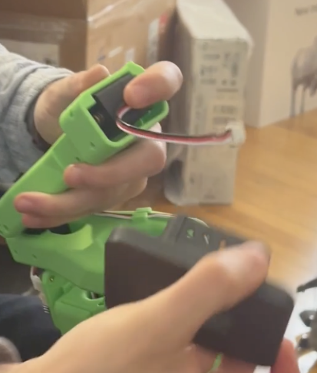

#### 2. 头顶摄像头安装

用于单手动或双手动设置中的鸟瞰视图。
(SO100/101)

| Webcam  | 32×32 Cam Module |
|:---------------------:|:-------------------:|
 | 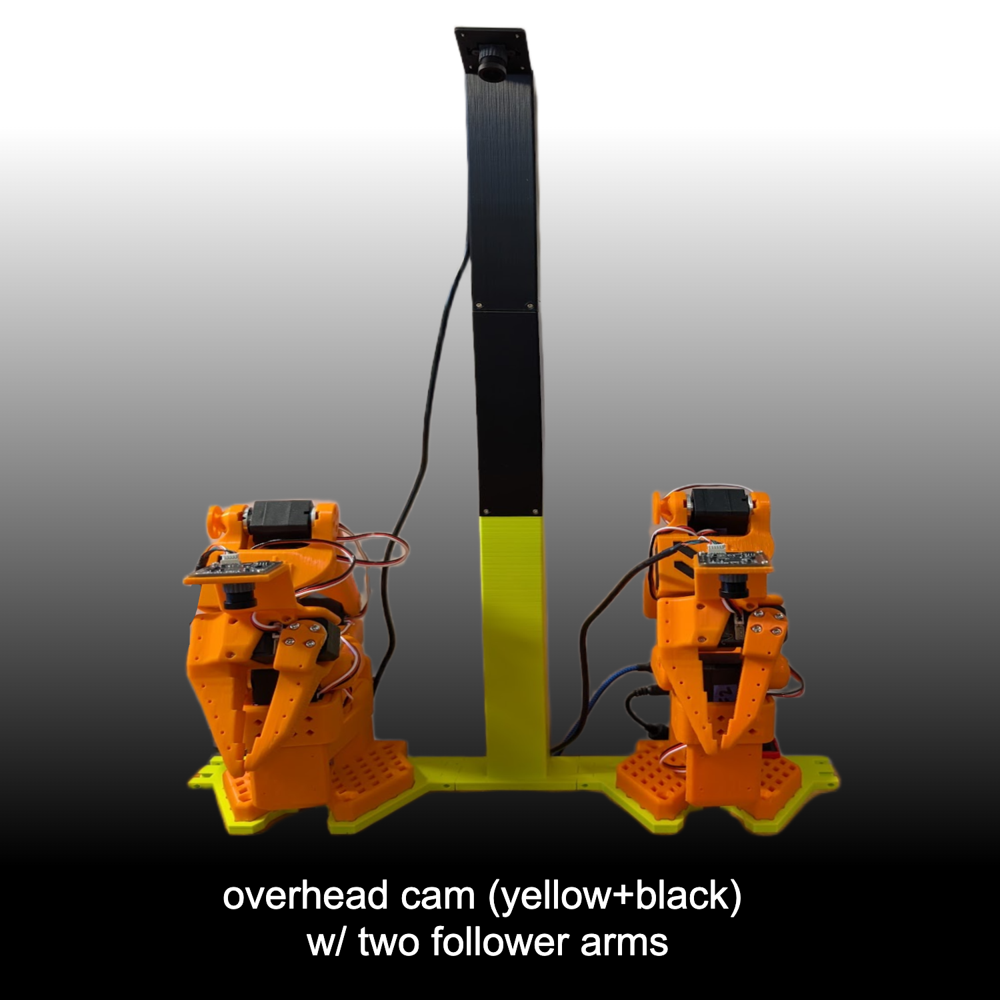 
| [Instructions](Optional/Overhead_Cam_Mount_Webcam/README.md) | [Instructions](Optional/Overhead_Cam_Mount_32x32_UVC_Module/README.md) 

#### 3. 底座安装

| Raised Leader Base | 4040 Aluminum Profile Mount |
|:-------------------:|:---------------------------:|
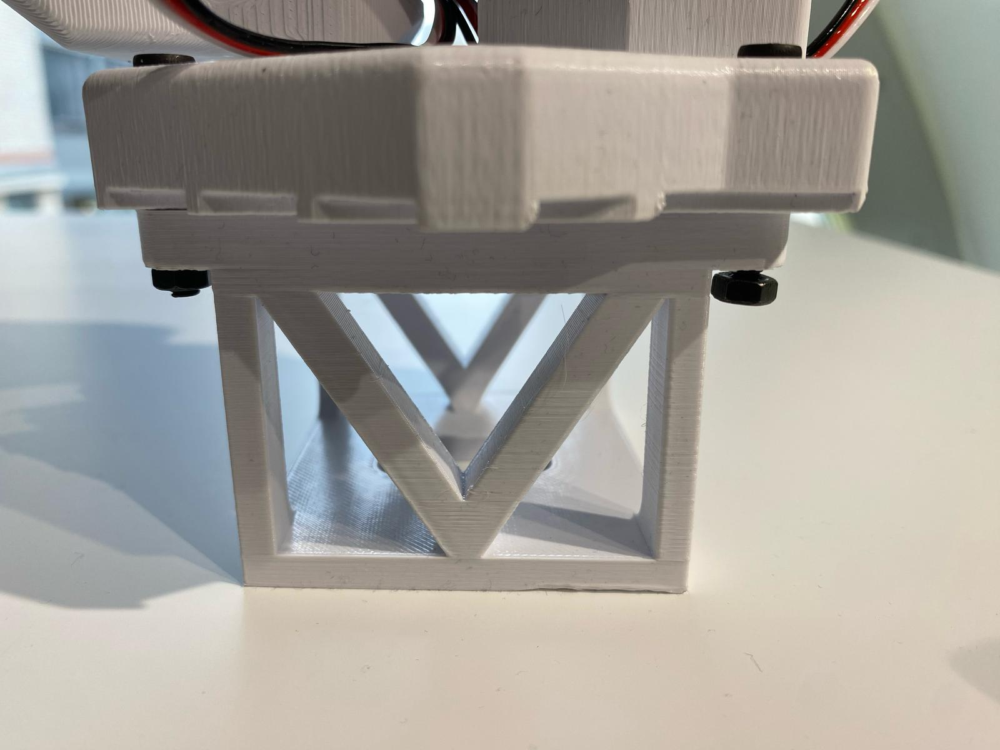 | 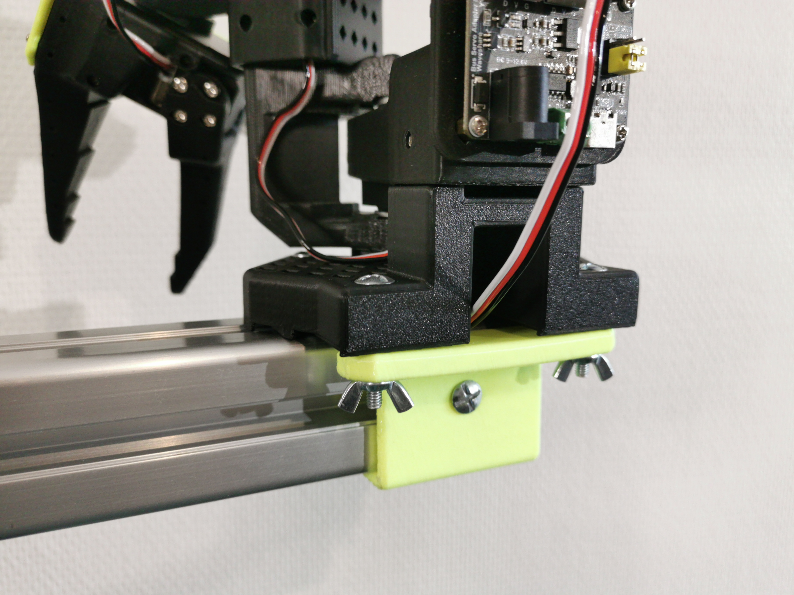  
[Download STL](Optional/Raised_Base/Raised_Base_Extension.stl) | [Instructions](Optional/4040_Base_Mount/README.md)

#### 4. 触觉感应（AnySkin）
为您的夹具添加触摸感应功能。

[→ Find on WOWROBO](https://shop.wowrobo.com/products/enhanced-anyskin-premium-crafted-editionwowskin)

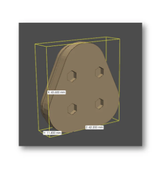

#### 5. 腕戴式相机

| 32×32 UVC Hex Nut (SO101) | 32×32 UVC Integrated (SO100/101) | 32×32 UVC Plug‑on | RealSense D405 | RealSense D435/D435I | Webcam (Vinmooog) |
| --- | --- | --- | --- | --- | --- |
| 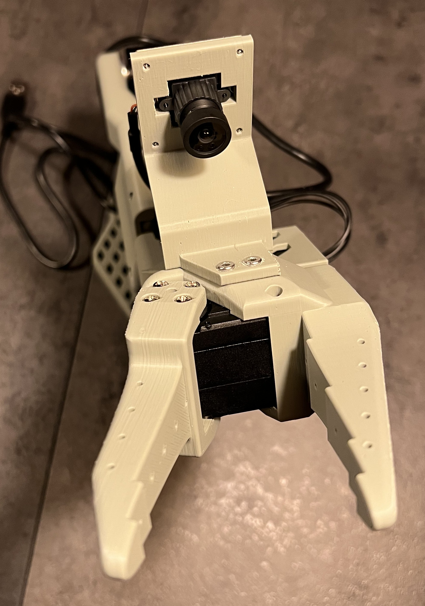 | 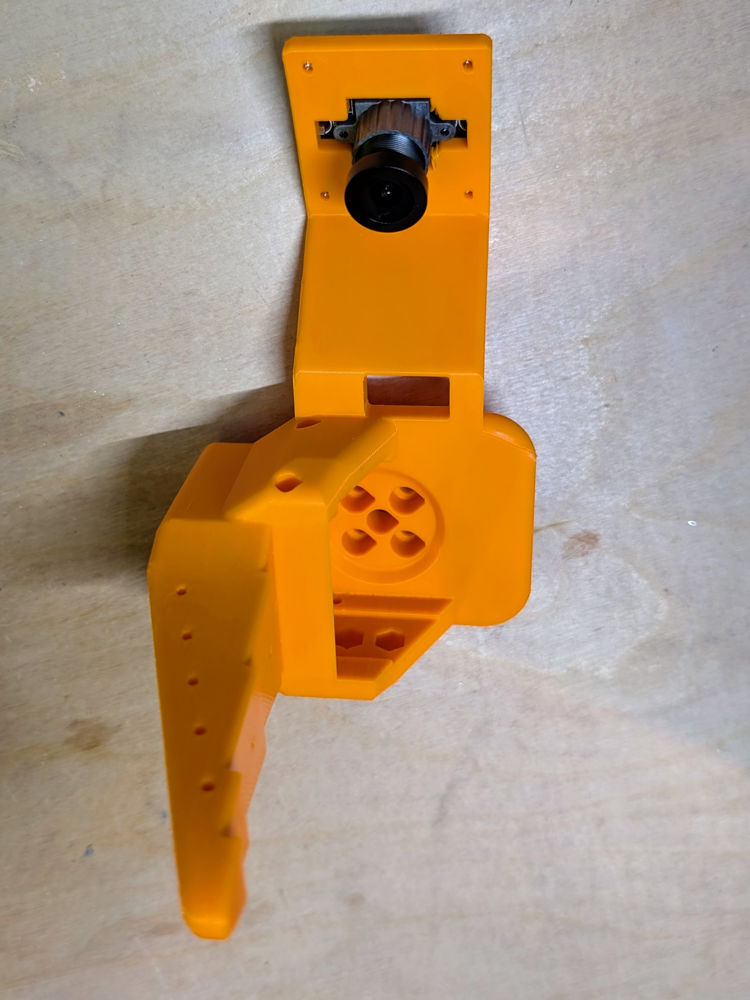 | 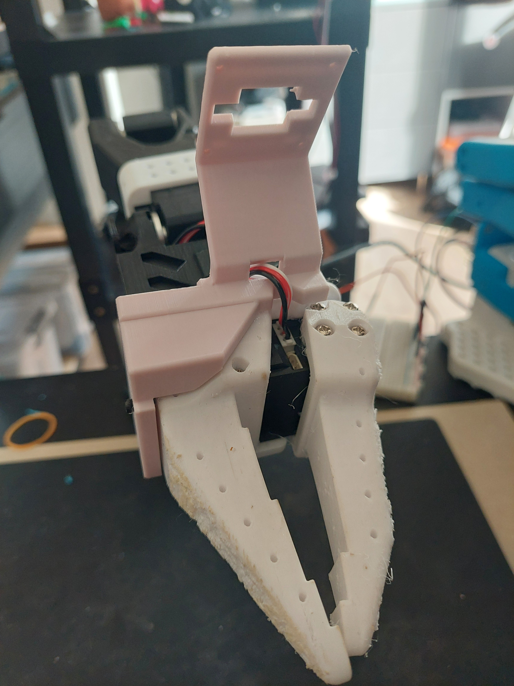 | 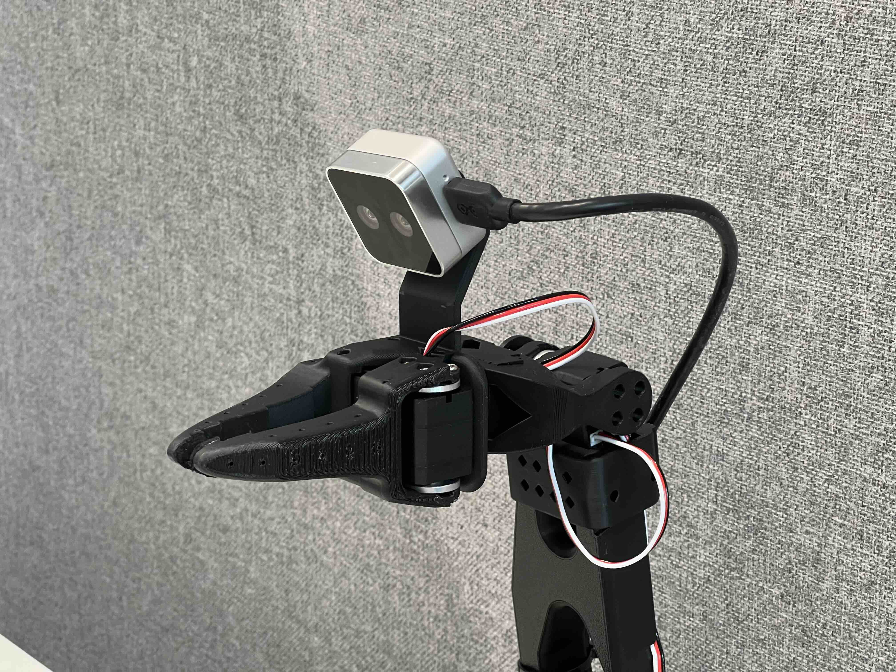 | 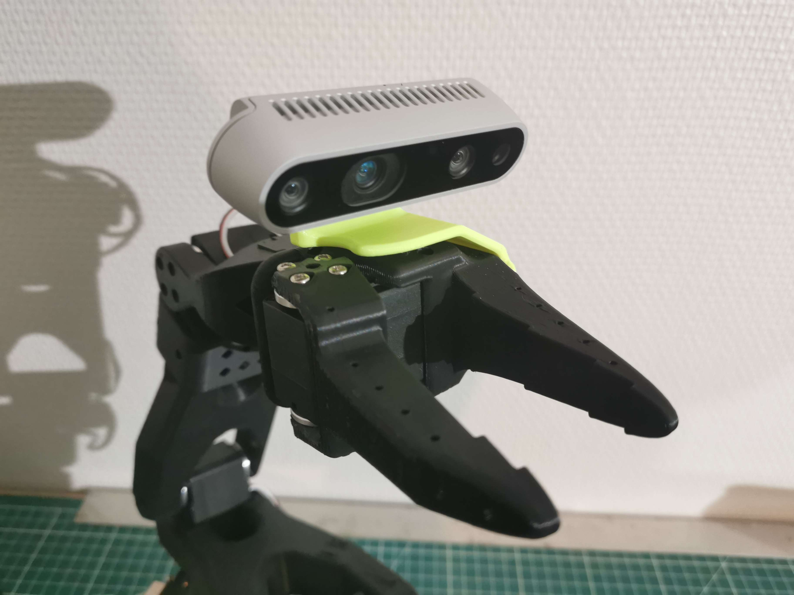 | 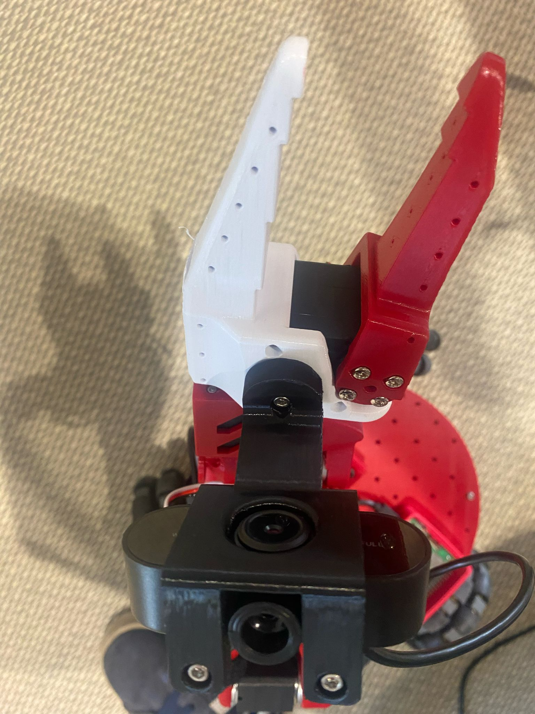 |
| [Instructions](Optional/SO101_Wrist_Cam_Hex-Nut_Mount_32x32_UVC_Module) | [Instructions](Optional/Wrist_Cam_Mount_32x32_UVC_Module/README.md) | [Instructions](Optional/Wrist_Cam_Plug_Mount_32x32_UVC_Module) | [Instructions](Optional/Wrist_Cam_Mount_RealSense_D405) | [Instructions](Optional/Wrist_Cam_Mount_RealSense_D435) | [Instructions](Optional/Wrist_Cam_Mount_Vinmooog_Webcam) |

#### 6. 顺应夹具
下载兼容的夹具零件并使用 TPU 95A 等柔性灯丝打印它们，为您的夹具增加一些灵活性。

[→ View README](Optional/Compliant_Gripper/README.md). 

#### 7. 顺应夹具（新）
手指采用 TPU 95A 印刷，底座采用 PLA 印刷。
更好的结构和更好的把握（精度和力量）。无需打印 TPU 手指的支撑。需要 2 个额外的 M3 螺钉，可选的 3M 胶带以提高摩擦力。

[→ Find on XLeRobot](https://github.com/Vector-Wangel/XLeRobot/tree/main/hardware)

## 调试电机
为了进行调试，任何 Windows PC 都可以通过 USB 连接来对伺服系统进行编程并进行调试或测试。为此，请下载[Feetech Software](https://www.feetechrc.com/software.html)。对于 Ubuntu，您可以使用[FT_SCServo_Debug_Qt](https://github.com/Kotakku/FT_SCServo_Debug_Qt)。注意：此步骤不是必需的，因为可以使用LeRobot库配置电机，但这有助于调试。

