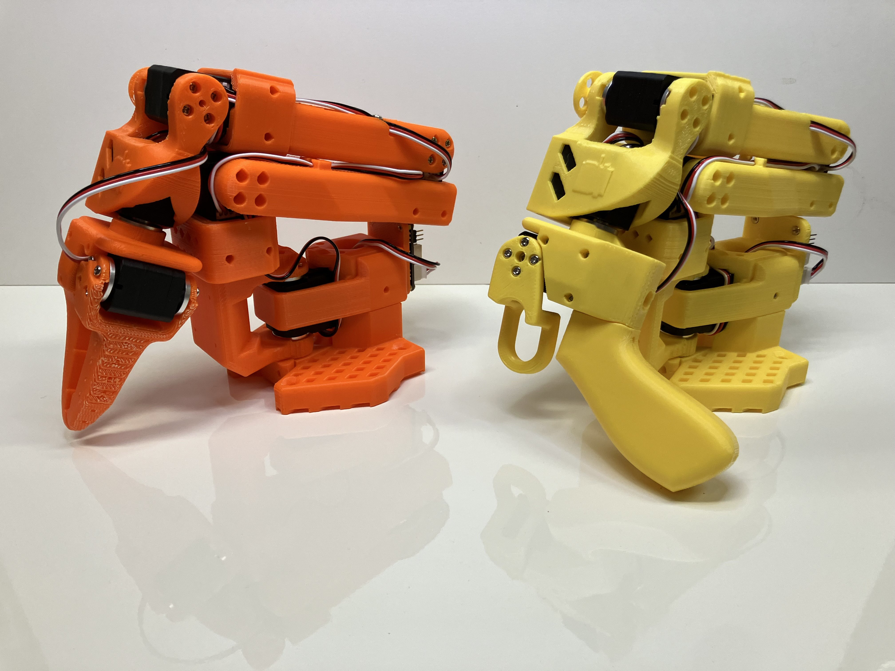

   <h1>Standard Open SO-100 Arm</h1>
   

      

  

SO-100手臂是[RobotStudio](https://www.therobotstudio.com)与[Hugging Face](https://huggingface.co/lerobot)合作设计的原创机器人手臂。

## 采购零件

这种远程操作装置的从动臂和引导臂几乎与现成的部件相同。如果您计划创建与`LeRobot`库一起使用的经典远程操作设置，请从下面的两臂零件购买。

目前我们仅提供美国、欧盟和中国的链接。如果您找到其他国家/地区的链接，请创建问题或 PR，以便我们将其添加到列表中。请注意，价格和商品可能会因地理位置而异。

#### 两个手臂的零件（标准遥控设置）：

| Part                                        | Amount | Unit Cost (US) | Buy US                                                                                                    | Unit Cost (EU) | Buy EU                                                                                            | Unit Cost (RMB) | Buy CN                                                                          |
| ------------------------------------------- | ------ | -------------- | --------------------------------------------------------------------------------------------------------- | -------------- | ------------------------------------------------------------------------------------------------- | --------------- | ------------------------------------------------------------------------------- |
| STS3215 Servo[1](#myfootnote1)   | 12     | $15            | [Alibaba](https://www.alibaba.com/product-detail/6PCS-7-4V-STS3215-Servos-for_1600523509006.html)         | 13€            | [Alibaba](https://www.alibaba.com/product-detail/6PCS-7-4V-STS3215-Servos-for_1600523509006.html) | ￥97.72         | [TaoBao](https://item.taobao.com/item.htm?id=712179366565&skuId=5268252241438)  |
| Motor Control Board                         | 2      | $11            | [Amazon](https://www.amazon.com/Waveshare-Integrates-Control-Circuit-Supports/dp/B0CTMM4LWK/)             | 12€            | [Amazon](https://www.amazon.fr/-/en/dp/B0CJ6TP3TP/)                                               | ￥27            | [TaoBao](https://detail.tmall.com/item.htm?id=738817173460&skuId=5096283384143) |
| USB-C Cable 2 pcs                           | 1      | $7             | [Amazon](https://www.amazon.com/Charging-etguuds-Charger-Braided-Compatible/dp/B0B8NWLLW2/?th=1)          | 7€             | [Amazon](https://www.amazon.fr/dp/B07BNF842T/)                                                    | ￥23.9\*2       | [TaoBao](https://detail.tmall.com/item.htm?id=44425281296&skuId=5611379016222)  |
| Power Supply[2](#myfootnote2)    | 2      | $10            | [Amazon](https://www.amazon.com/Facmogu-Switching-Transformer-Compatible-5-5x2-1mm/dp/B087LY41PV/)        | 13€            | [Amazon](https://www.amazon.fr/-/en/dp/B01HRR9GY4/)                                               | ￥22.31         | [TaoBao](https://item.taobao.com/item.htm?id=544824248494&skuId=4974994129990)  |
| Table Clamp 4pcs                            | 1      | $9             | [Amazon](https://www.amazon.com/TAODAN-Trigger-Ratchet-Woodworking-Processes/dp/B0DJNXF8WH?rps=1&sr=1-18) | ￥9.2          | [TaoBao](https://detail.tmall.com/item.htm?id=801399113134&skuId=5633627126649)                   |
| Screwdriver Set[3](#myfootnote3) | 1      | $6             | [Amazon](https://www.amazon.com/Precision-Phillips-Screwdriver-Electronics-Computer/dp/B0DB227RTH)        | 10€            | [Amazon](https://www.amazon.fr/dp/B08ZXVMVYD/)                                                    | ￥14.9          | [TaoBao](https://detail.tmall.com/item.htm?id=675684600845&skuId=4856851392176) |
| Total                                       | ---    | $232           | ---                                                                                                       | 244€           | ---                                                                                               | ￥1343.16       | ---                                                                             |

#### 一只手臂的零件：

| Part                                        | Amount | Unit Cost (US) | Buy US                                                                                                                                                | Unit Cost (EU) | Buy EU                                                                                                                                                | Unit Cost (RMB) | Buy CN                                                                          |
| ------------------------------------------- | ------ | -------------- | ----------------------------------------------------------------------------------------------------------------------------------------------------- | -------------- | ----------------------------------------------------------------------------------------------------------------------------------------------------- | --------------- | ------------------------------------------------------------------------------- |
| STS3215 Servo[1](#myfootnote1)   | 6      | $14            | [Alibaba](https://www.alibaba.com/product-detail/Top-Seller-Low-Cost-Feetech-STS3215_1600999461525.html?spm=a2747.product_manager.0.0.11be71d2ARQb82) | 13€            | [Alibaba](https://www.alibaba.com/product-detail/Top-Seller-Low-Cost-Feetech-STS3215_1600999461525.html?spm=a2747.product_manager.0.0.11be71d2ARQb82) | ￥97.72         | [TaoBao](https://item.taobao.com/item.htm?id=712179366565&skuId=5268252241438)  |
| Motor Control Board                         | 1      | $11            | [Amazon](https://www.amazon.com/Waveshare-Integrates-Control-Circuit-Supports/dp/B0CTMM4LWK/)                                                         | 12€            | [Amazon](https://www.amazon.fr/-/en/dp/B0CJ6TP3TP/)                                                                                                   | ￥27            | [TaoBao](https://detail.tmall.com/item.htm?id=738817173460&skuId=5096283384143) |
| USB-C Cable 2 pcs                           | 1      | $7             | [Amazon](https://www.amazon.com/Charging-etguuds-Charger-Braided-Compatible/dp/B0B8NWLLW2/?th=1)                                                      | 7€             | [Amazon](https://www.amazon.fr/dp/B07BNF842T/)                                                                                                        | ￥23.9          | [TaoBao](https://detail.tmall.com/item.htm?id=44425281296&skuId=5611379016222)  |
| Power Supply[2](#myfootnote2)    | 1      | $10            | [Amazon](https://www.amazon.com/Facmogu-Switching-Transformer-Compatible-5-5x2-1mm/dp/B087LY41PV/)                                                    | 13€            | [Amazon](https://www.amazon.fr/-/en/dp/B01HRR9GY4/)                                                                                                   | ￥22.31         | [TaoBao](https://item.taobao.com/item.htm?id=544824248494&skuId=4974994129990)  |
| Table Clamp 2pcs                            | 1      | $5             | [Amazon](https://www.amazon.com/Mr-Pen-Carpenter-Clamp-6inch/dp/B092L925J4/)                                                                          | 8€             | [Amazon](https://www.amazon.fr/-/en/dp/B08HZ1QRBF/)                                                                                                   | ￥7.8           | [TaoBao](https://detail.tmall.com/item.htm?id=738636473238&skuId=5505939904942) |
| Screwdriver Set[3](#myfootnote3) | 1      | $6             | [Amazon](https://www.amazon.com/Precision-Phillips-Screwdriver-Electronics-Computer/dp/B0DB227RTH)                                                    | 10€            | [Amazon](https://www.amazon.fr/dp/B08ZXVMVYD/)                                                                                                        | ￥14.9          | [TaoBao](https://detail.tmall.com/item.htm?id=675684600845&skuId=4856851392176) |
| Total                                       | ---    | $123           | ---                                                                                                                                                   | 128€           | ---                                                                                                                                                   | ￥682.23        | ---                                                                             |

## 打印零件

可以使用各种 3D 打印机来打印从动臂和引导臂所需的零件。请按照以下步骤操作以确保打印效果良好。

1. 选择打印机：提供的 STL 文件可在许多 FDM 打印机上打印。以下是经过测试和建议的设置，但其他设置也可能有效。
   1. 材质：PLA
   2. 喷嘴直径和精度：0.2mm层高时0.4mm喷嘴直径或0.4mm层高0.6mm喷嘴。
   3. 填充密度：13%
   4. 示例打印机：[Prusa MINI+](https://www.prusa3d.com/product/original-prusa-mini-semi-assembled-3d-printer-4/)、[UP Plus 2](https://shop.tiertime.com/product/tiertime-up-plus-2-3d-printer/)、[Creality Ender 3](https://www.amazon.com/Comgrow-Creality-Ender-Aluminum-220x220x250mm/dp/B07BR3F9N6/)、[Bambu Lab A/P/X-series](https://bambulab.com)
2. 设置打印机
   1. 设置和拆除
      1. Ensure that the printer is calibrated and the bed level is correctly set using the printer specific instructions.
      2. Clean the print bed, making sure it is free from dust, or grease. If cleaning the bed using water, or other liquid, dry the bed.
      3. If your printer recommends it, use a standard glue stick and apply a thin, even layer of glue across the print area of the bed. Avoid clumping or uneven application.
      4. Load the printer filament using printer specific instructions.
      5. Ensure the printer settings match the ones suggested above (most printers have multiple settings so choose the ones that most closely match).
      6. Set for supports everywhere but ignore slopes greater than 45 degrees to the horizontal.
      7. There should be no supports in the screw holes with horizontal axes.
3. 检查打印机准确性
   1. 在[Gauges](/stl_files_for_3dprinting/Gauges)文件夹中，有两种类型的仪表，一种用于对照标准 4x2 乐高积木检查打印尺寸，另一种用于对照 STS3215 伺服系统。
      1. If you have a STS3215 servo, print:
         1. [Gauge Zero](/stl_files_for_3dprinting/Gauges/Gauge_0.STL)
         2. [Gauge Tight](/stl_files_for_3dprinting/Gauges/Gauge_tight_1.STL)
      2. If you have a standard lego block, print:
         1. [Gauge Zero](/stl_files_for_3dprinting/Gauges/Lego_Size_Test_02_zero.STL)
         2. [Gauge -0.1](/stl_files_for_3dprinting/Gauges/Lego_Size_Test_02_minuspoint1.STL)
   2. 针对给定物体（乐高或伺服）测试量规 0。配合应该与此[tutorial](https://youtu.be/dss8E3DG2rA)类似。
   3. 如果合适，请转到步骤 4，否则，请更改打印机设置并重试，否则会产生问题。
4. 打印零件：引导器或从动器的所有零件都包含在一个文件中，z 方向正确向上，以最大限度地减少支撑。

   1. 对于尺寸为 220mmx220mm 的打印机床（例如 Ender），打印以下文件：
      1. [Follower](/stl_files_for_3dprinting/Follower/Print_Follower_SO_ARM100_08k_Ender.STL)
      2. [Leader](/stl_files_for_3dprinting/Leader/Print_Leader_SO_ARM100_08k_Ender.STL)
   2. 对于尺寸为 205 毫米 x 250 毫米的打印机床（例如 Prusa/Up）：
      1. [Follower](/stl_files_for_3dprinting/Follower/Print_Follower_SO_ARM100_08k_UP_Prusa.STL)
      2. [Leader](/stl_files_for_3dprinting/Leader/Print_Leader_SO_ARM100_08k_UP_Prusa.STL)
   3. 对于 Bambu Lab A 系列：
      1. Follower ([Part 1](/stl_files_for_3dprinting/Follower/Print_Follower_SO_ARM100_08k_UP_BambuLabA1Mini_part1.STL)) ([Part 2](/stl_files_for_3dprinting/Follower/Print_Follower_SO_ARM100_08k_UP_BambuLabA1Mini_part2.STL))
      2. Leader ([Part 1](/stl_files_for_3dprinting/Leader/Print_Leader_SO_ARM100_08k_UP_BambuLabA1Mini_part1.stl)) ([Part 2](/stl_files_for_3dprinting/Leader/Print_Leader_SO_ARM100_08k_UP_BambuLabA1Mini_part2.stl))
   4. 适用于 Bambu Lab P 系列和 X 系列
      1. [Follower](/stl_files_for_3dprinting/Follower/Print_Follower_Bambu_P1P.3mf)
      2. [Leader](/stl_files_for_3dprinting/Leader/Print_Leader_Bambu_P1P.3mf)

5. 记录下来
   1. 打印完成后，使用油灰刀将零件从打印床上刮掉。
   2. 去除零件上的所有支撑材料。

### 没有 3D 打印机？
转到这里：[Printing services](./3DPRINT.md)

## 组装教程、数据收集和AI培训

遵循[complete guide of LeRobot](https://huggingface.co/docs/lerobot/so100)。

它指向[our video tutorial](https://www.youtube.com/watch?v=FioA2oeFZ5I&ab_channel=HuggingFace)。
注意：我们最后取消了自动校准，转而采用更稳健的手动校准。
