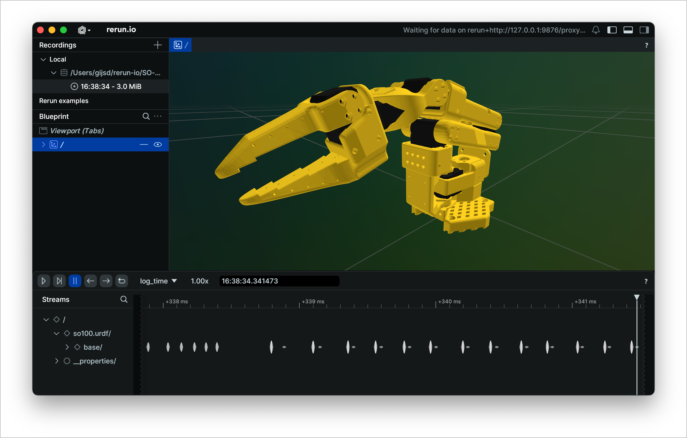

<a id="simulation-models-for-so100-and-so101"></a>
# SO100 和 SO101 的仿真模型

此文件夹包含**SO100**和**SO101**的仿真文件。

## SO100

- 包含 SO100 机器人的单个**URDF**文件。
- 要可视化**URDF**，您可以将[rerun](https://www.rerun.io/)与[URDF visualizer plugin](https://github.com/rerun-io/rerun-loader-python-example-urdf#installing-the-plugin)一起使用



```bash
rerun Simulation/SO100/so100.urdf
````

## SO101

- 包含用于模拟的**URDF**和**MJCF**(MuJoCo) 文件。
- 要可视化**URDF**文件，您可以将[rerun](https://www.rerun.io/)与[URDF visualizer plugin](https://github.com/rerun-io/rerun-loader-python-example-urdf#installing-the-plugin)一起使用

```bash
rerun Simulation/SO101/so101_new_calib.urdf
rerun Simulation/SO101/so101_old_calib.urdf
```

- 有关更多详细信息：
  - **旧版**和**新校准**URDF 之间的差异。
  - 如何从 CAD 模型生成**MJCF**文件。

👉 查看文件[`Simulation/SO101/README.md`](Simulation/SO101/README.md)。
